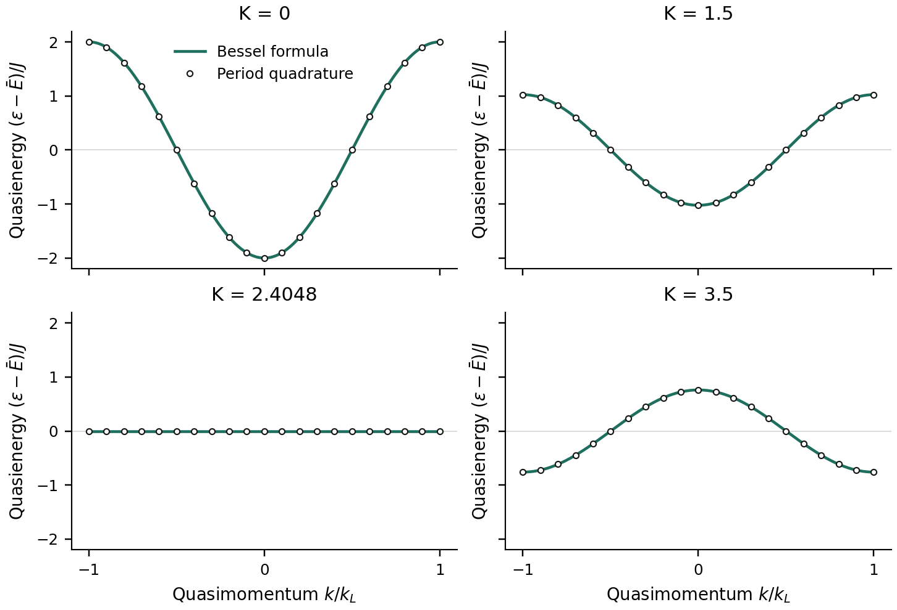
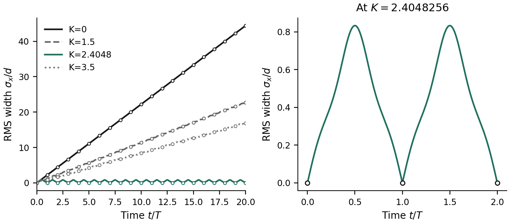

# From Bloch Bands to Floquet Bands

**Controlling atomic transport in a one-dimensional optical lattice**

A reproducible solid-state physics course project based on Martin Holthaus's
*Floquet engineering with quasienergy bands of periodically driven optical lattices*.
It follows the calculation from a stationary cosine potential to shaken-lattice
quasienergy bands and wave-packet dynamics.

Read the [academic report](report.pdf), edit its [LaTeX source](report.tex), or
start with the [plane-wave basis guide](docs/plane_wave_basis.md).
Sections 2.2 and 2.3 of the report follow the lecture convention
`psi_nk`, `E_nk`, `c_(k-K)^(n)`, and `U_(K'-K)`, with an explicit translation to
the numerical implementation.



## What the project demonstrates

- Static Bloch bands from a plane-wave Hamiltonian and the accuracy of a
  nearest-neighbor tight-binding approximation.
- Floquet bands and the tunneling law $J_{\mathrm{eff}}=J\mathcal{J}_0(K)$.
- Band narrowing, dynamic localization and inverted dispersion.
- Probability distributions, RMS widths, motion within each cycle and
  complete-cycle revivals.
- Reversed drift for the same initial nonzero central quasimomentum.
- Residual bandwidth from longer-range hopping and a bounded example of
  resonant interband excitation.

All figures are calculations of stated models. No experimental measurements
are digitized or fitted, and no novelty is claimed. The report discusses the
experiments of Lignier et al. (2007) and Eckardt et al. (2009), including what
additional modeling a quantitative comparison would require.

## Run the calculations

Use Python 3.10 or later. From the repository root:

```bash
python -m venv .venv
source .venv/bin/activate
python -m pip install -r requirements.txt
python code/run_all.py
```

On Windows, activate the environment with `.venv\Scripts\activate`.
The dependencies are NumPy, SciPy and Matplotlib. Python plotting does not
require LaTeX or external data.

The driver regenerates the figures and saved arrays, then runs the acceptance
checks in `code/convergence.py`. It raises an exception if a check fails.
It also records package versions, elapsed time and scientific-output hashes in
`results/execution_record.json`. Rerunning overwrites generated outputs.

Individual calculations can also be run:

```bash
python code/static_bands.py
python code/single_band.py
python code/wavepackets.py
python code/multiband.py
python code/convergence.py
```



## Suggested learning order

1. Read report Sections 2.1–2.3 and the [basis guide](docs/plane_wave_basis.md).
   Understand how a fixed Bloch wave number labels a block of the Hamiltonian.
2. Run `static_bands.py` and examine how changing lattice depth alters the bands.
3. Read the tight-binding derivation and compare the cosine approximation with
   the continuum band.
4. Read the moving-frame and Floquet derivations, then run `single_band.py`.
5. Run `wavepackets.py` and compare full-cycle observations with motion within
   a cycle. Use directed drift to detect the sign of tunneling.
6. Inspect the longer-range and multiband comparisons before applying the
   single-band predictions to a physical experiment.

## Files

| Path | Purpose |
|---|---|
| `report.pdf` | Complete academic report with derivations, figures and references |
| `report.tex` | Editable report source; bibliography is embedded |
| `docs/plane_wave_basis.md` | Lecture notation, infinite matrix and finite cutoff explained |
| `code/common.py` | Units, static Bloch matrix, Fourier extraction and plotting style |
| `code/static_bands.py` | Static bands and tight-binding comparison |
| `code/single_band.py` | Quasienergy bands, effective tunneling and longer-range corrections |
| `code/wavepackets.py` | Full time-dependent nearest-neighbor propagation and observables |
| `code/multiband.py` | Continuum monodromy and resonant interband excitation |
| `code/convergence.py` | Independent benchmarks and discretization checks |
| `code/run_all.py` | Complete numerical run and output hashes |
| `figures/` | Vector PDF and PNG plots |
| `results/` | Numerical summaries, CSV table and compressed NumPy arrays |
| `validation/` | Execution provenance and validation records |
| `sources.md` | Primary-source references and notation/claim crosswalk |

Load a saved array with `numpy.load("results/static_bands.npz")`; the other
`.npz` files correspond to their calculation scripts.

## Conventions and limits

The potential is $V(x)=sE_{\mathrm R}\sin^2(k_{\mathrm L}x)$ with spacing
$d=\pi/k_{\mathrm L}$ and recoil energy
$E_{\mathrm R}=\hbar^2k_{\mathrm L}^2/(2m)$.
The code uses dimensionless quasimomentum `q=kd`.
The continuum frequency is `Omega_R=hbar*omega/E_R`; the packet examples use
`Omega_J=hbar*omega/J=4`. These frequency units are different.

The Bessel tunneling law and exact revival are exact within the homogeneous,
noninteracting nearest-neighbor model. The longer-range calculation still
assumes an isolated band. The continuum comparison covers `s=8`, `K=0.35`,
`k=0`, two frequencies and at most 20 periods. It is not a global stability map
or an interacting-condensate simulation.

## Rebuild the report

With a standard TeX Live or MiKTeX installation, run this command three times:

```bash
pdflatex -interaction=nonstopmode -halt-on-error report.tex
```

No BibTeX step is needed. Generate the figures first if they are absent.

## Principal references

- M. Holthaus, *J. Phys. B* **49**, 013001 (2016).
  [DOI](https://doi.org/10.1088/0953-4075/49/1/013001),
  [arXiv:1510.09042](https://arxiv.org/abs/1510.09042).
- H. Lignier et al., *Phys. Rev. Lett.* **99**, 220403 (2007).
  [DOI](https://doi.org/10.1103/PhysRevLett.99.220403).
- A. Eckardt et al., *Phys. Rev. A* **79**, 013611 (2009).
  [DOI](https://doi.org/10.1103/PhysRevA.79.013611).

Lecture notation is acknowledged in the revised report. The instructor's
lecture PDFs are not redistributed in this repository.
