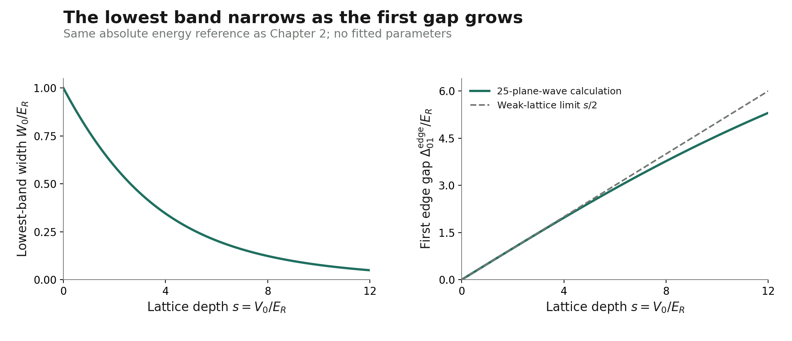

# From Bloch bands to Floquet bands

### Chapter 2 · Stationary optical lattice and Bloch bands

**How does a periodic potential turn free-particle crossings into energy bands?**
This repository calculates the stationary bands of a one-dimensional optical lattice directly from the plane-wave matrix derived in Chapter 2 of my course report. Increasing the lattice depth opens gaps and makes the lowest band flatter.

**Lakshya Bhardwaj · Physics, Arizona State University**

## Watch the bands form


The left panel shows the potential; the right shows the three lowest bands over the first Brillouin zone. The lattice depth sweeps from $s=0$ to $12$ and back. Both energy scales stay fixed, and the bandwidth and first edge gap are calculated at every frame.

This is a sequence of **stationary eigenproblems**, rather than a time-dependent evolution of an atom. The animation is a looping GIF embedded directly in this README.

## Follow a point along a band


At fixed depth $s=4$, the moving markers identify the three energies at a selected $k$. The right panel shows the lowest eigenstate's plane-wave probabilities $|a_{0\ell}(k)|^2$. Near a zone edge, the two counterpropagating momentum components mix. The displayed reciprocal indices are $-4\leq\ell\leq4$; the small omitted weight is reported above the panels. This scan does not apply an external force or simulate dynamics.

## The calculation

The lattice Hamiltonian and recoil energy are

$$
H_0=\frac{p^2}{2m}+V_0\sin^2(k_Lx),\qquad
E_R=\frac{\hbar^2k_L^2}{2m},\qquad s=\frac{V_0}{E_R},\qquad d=\frac{\pi}{k_L}.
$$

Following the report's lecture notation, use the basis $e^{i(k-2\ell k_L)x}$ and write $\kappa=k/k_L$. Equation (2.27) becomes

$$
h_{\ell\ell'}(\kappa)=
\left[(\kappa-2\ell)^2+\frac{s}{2}\right]\delta_{\ell\ell'}
-\frac{s}{4}\left(\delta_{\ell',\ell+1}+\delta_{\ell',\ell-1}\right).
$$

Diagonalizing this real symmetric tridiagonal matrix at each $\kappa\in[-1,1]$ gives $E_n(k)/E_R$. The reciprocal-vector index $\ell$ labels basis components; the band index $n$ labels the energy-sorted eigenstates. The calculation retains $\ell=-12,\ldots,12$, giving 25 plane waves.

The mean potential $V_0/2$ is included in every absolute energy. The points $k=\pm k_L$ represent the same Brillouin-zone boundary; both appear in plots to show the full zone, while Fourier averages use a half-open grid.

## Static band structure


All four panels use the same energy scale. The solid teal curve is the lowest band; dashed and dotted curves are the next two bands. The pale region marks the first forbidden energy interval. These are continuum-lattice results from the finite plane-wave basis, not a nearest-neighbor approximation.

## Bandwidth and the first gap



The quantities from Eq. (2.30) are

$$
W_0=\max_k E_0(k)-\min_k E_0(k),\qquad
\Delta_{01}^{\mathrm{edge}}=E_1(k_L)-E_0(k_L).
$$

At weak depth, the two resonant plane waves give $\Delta_{01}^{\mathrm{edge}}/E_R\simeq s/2$. The dashed curve shows this limiting approximation; the full calculation includes mixing with additional plane waves.

The following values reproduce Table 2.1 of the report. Every energy and hopping entry is in units of $E_R$.

| Depth $s$ | $E_0(0)/E_R$ | $E_0(k_L)/E_R$ | $W_0/E_R$ | $\Delta_{01}^{\mathrm{edge}}/E_R$ | $J_1/E_R$ |
|---:|---:|---:|---:|---:|---:|
| 2 | 0.878234 | 1.470654 | 0.592420 | 0.996112 | 0.142755 |
| 4 | 1.544861 | 1.889751 | 0.344890 | 1.969357 | 0.085490 |
| 8 | 2.486043 | 2.609323 | 0.123280 | 3.769876 | 0.030799 |
| 12 | 3.165608 | 3.214620 | 0.049012 | 5.304419 | 0.012252 |

Full-precision results: [reference table](data/chapter2_table.csv) · [depth sweep](data/depth_sweep.csv).

## From the continuum band to tight binding


Section 2.5 expands the isolated lowest band as

$$
E_0(q)=\overline E-2\sum_{j\geq1}J_j\cos(jq),\qquad q=kd=\pi\kappa.
$$

The nearest-neighbor model retains only $J_1$, giving $E_{\mathrm{NN}}(q)=\overline E-2J_1\cos q$. Here $J_1$ is extracted from the continuum band by the Fourier integral in Eq. (2.37); it is not fitted or set equal to $W_0/4$.

For $s=2$ and $8$, the maximum dispersion errors divided by the full continuum bandwidth are approximately **9.22%** and **1.07%**. A deeper lattice improves this approximation. These numbers describe model error, not experimental uncertainty.

## Reproduce everything

Use Python 3.10 or newer. From the repository root:

```bash
python -m venv .venv
```

Activate the environment on macOS/Linux with `source .venv/bin/activate`, or in Windows PowerShell with `.venv\Scripts\Activate.ps1`, then run:

```bash
python -m pip install -r requirements.txt
python -m unittest discover -s tests -v
python src/generate.py
```

To regenerate only the static figures and numerical data:

```bash
python src/generate.py --static-only
```

GIFs are generated with Pillow. No video file, FFmpeg installation, notebook server, or hosted website is needed. Change the depth list, momentum grid, or animation parameters in [generate.py](src/generate.py); the physical solver lives in [lattice.py](src/lattice.py).

| Path | Contents |
|---|---|
| [src/lattice.py](src/lattice.py) | Plane-wave solver, band metrics, Fourier hopping |
| [src/generate.py](src/generate.py) | Reproducible plots, data, and both GIFs |
| [tests/test_lattice.py](tests/test_lattice.py) | Seven independent physical and numerical checks |
| [assets](assets) | Embedded GIFs, PNG previews, and editable vector SVG figures |
| [data](data) | Band arrays, CSV tables, approximation errors, and recorded package versions |
| [METHODS.md](METHODS.md) | Equation mapping, benchmarks, numerical conventions, and scope |

## Validation and scope

The seven checks cover the folded free-particle spectrum, independent Mathieu characteristic values at the band edges, inversion symmetry, convergence from $M=12$ to $16$, the weak-depth gap, Table 2.1, eigenvector residuals and normalization, and the tight-binding comparison. The recorded execution passed all seven tests; [validation.json](data/validation.json) records the numerical residuals and tested range.

This repository currently covers **Chapter 2's static, single-particle lattice**. The project title names the larger Bloch-to-Floquet course project; periodic shaking and Floquet quasienergies are outside this implementation. Atom–atom interactions, confinement, dissipation, and experimental noise are omitted. All results are deterministic model calculations.

Source: Lakshya Bhardwaj, *From Bloch Bands to Floquet Bands: Controlling Atomic Transport in a One-Dimensional Optical Lattice*, Chapter 2, supplied report. The uploaded source file's SHA-256 is recorded in [METHODS.md](METHODS.md). Background: Martin Holthaus, [*Floquet engineering with quasienergy bands of periodically driven optical lattices*](https://doi.org/10.1088/0953-4075/49/1/013001), J. Phys. B **49**, 013001 (2016).
