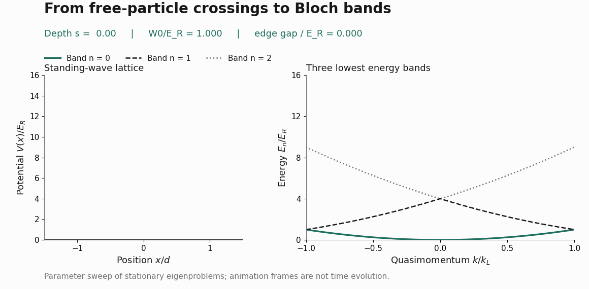
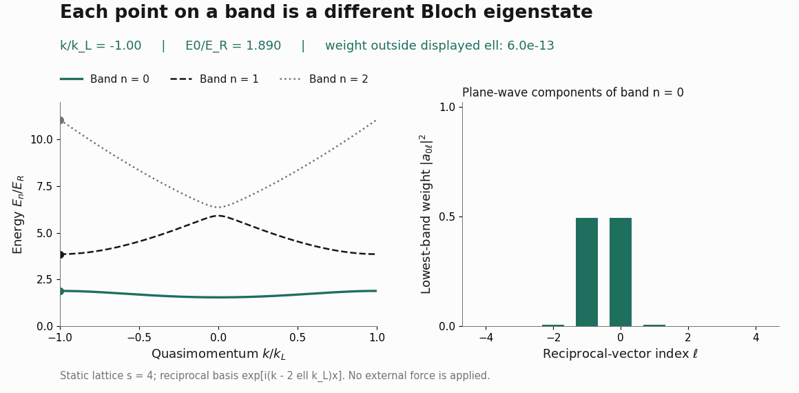
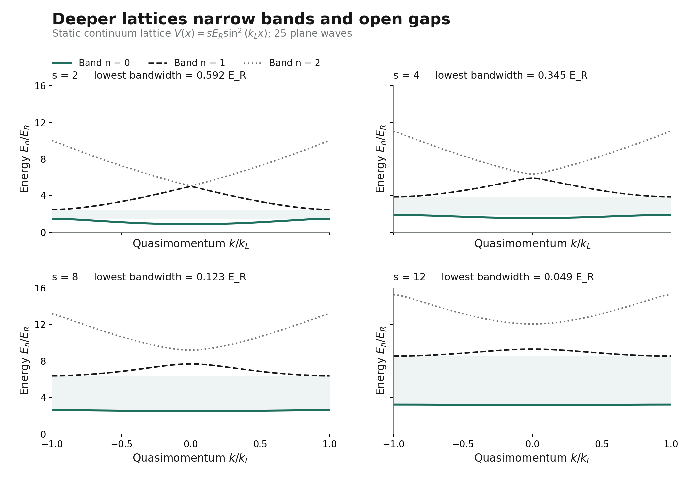
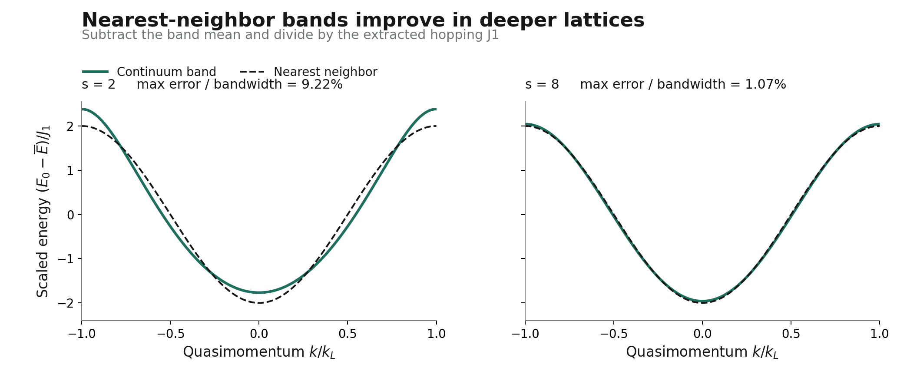

# PHY 581 Course project. From Bloch bands to Floquet bands (Work in progress)

**How does a periodic potential turn free-particle crossings into energy bands?**

**Lakshya Bhardwaj · Physics, Arizona State University**

## Follow a point along a band

## Calculations

The lattice Hamiltonian and recoil energy are

$$
H_0=\frac{p^2}{2m}+V_0\sin^2(k_Lx),\qquad
E_R=\frac{\hbar^2k_L^2}{2m},\qquad s=\frac{V_0}{E_R},\qquad d=\frac{\pi}{k_L}.
$$

Following the report's lecture notation, use the basis $e^{i(k-2\ell k_L)x}$ and write $\kappa=k/k_L$. Equation (2.27) becomes

$$
h_{\ell\ell'}(\kappa)=
\left[(\kappa-2\ell)^2+\frac{s}{2}\right]\delta_{\ell\ell'}
-\frac{s}{4}\left(\delta_{\ell',\ell+1}+\delta_{\ell',\ell-1}\right).
$$

Diagonalizing this real symmetric tridiagonal matrix at each $\kappa\in[-1,1]$ gives $E_n(k)/E_R$. The reciprocal-vector index $\ell$ labels basis components; the band index $n$ labels the energy-sorted eigenstates. The calculation retains $\ell=-12,\ldots,12$, giving 25 plane waves.

The mean potential $V_0/2$ is included in every absolute energy. The points $k=\pm k_L$ represent the same Brillouin-zone boundary; both appear in plots to show the full zone, while Fourier averages use a half-open grid.

## Static band structure

## Bandwidth and the first gap

$$
W_0=\max_k E_0(k)-\min_k E_0(k),\qquad
\Delta_{01}^{\mathrm{edge}}=E_1(k_L)-E_0(k_L).
$$

At weak depth, the two resonant plane waves give $\Delta_{01}^{\mathrm{edge}}/E_R\simeq s/2$. The dashed curve shows this limiting approximation; the full calculation includes mixing with additional plane waves.

The following values reproduce Table 2.1 of the report. Every energy and hopping entry is in units of $E_R$.

| Depth $s$ | $E_0(0)/E_R$ | $E_0(k_L)/E_R$ | $W_0/E_R$ | $\Delta_{01}^{\mathrm{edge}}/E_R$ | $J_1/E_R$ |
|---:|---:|---:|---:|---:|---:|
| 2 | 0.878234 | 1.470654 | 0.592420 | 0.996112 | 0.142755 |
| 4 | 1.544861 | 1.889751 | 0.344890 | 1.969357 | 0.085490 |
| 8 | 2.486043 | 2.609323 | 0.123280 | 3.769876 | 0.030799 |
| 12 | 3.165608 | 3.214620 | 0.049012 | 5.304419 | 0.012252 |

Full-precision results: [reference table](data/chapter2_table.csv) · [depth sweep](data/depth_sweep.csv).

## From the continuum band to tight binding

Section 2.5 expands the isolated lowest band as

$$
E_0(q)=\overline E-2\sum_{j\geq1}J_j\cos(jq),\qquad q=kd=\pi\kappa.
$$

The nearest-neighbor model retains only $J_1$, giving $E_{\mathrm{NN}}(q)=\overline E-2J_1\cos q$. Here $J_1$ is extracted from the continuum band by the Fourier integral in Eq. (2.37); it is not fitted or set equal to $W_0/4$.

For $s=2$ and $8$, the maximum dispersion errors divided by the full continuum bandwidth are approximately **9.22%** and **1.07%**. A deeper lattice improves this approximation. These numbers describe model error, not experimental uncertainty.

